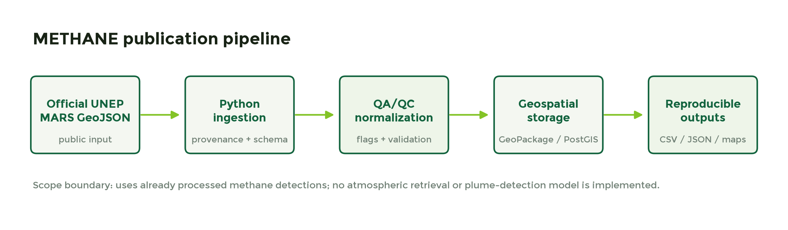
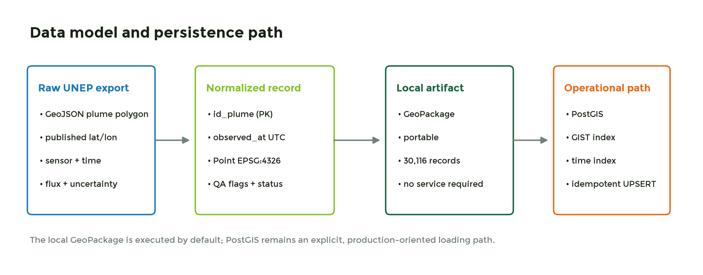
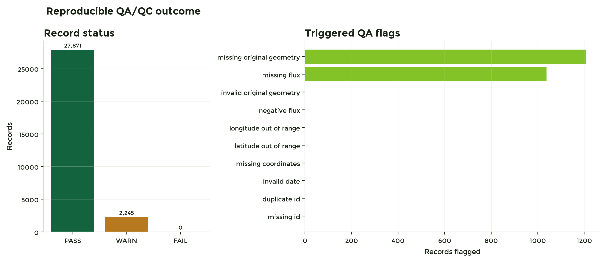
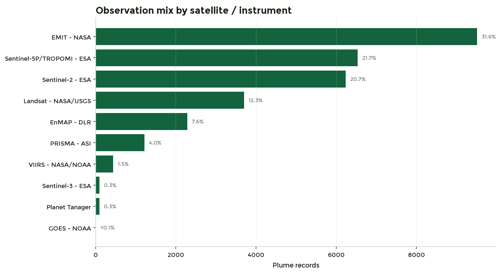
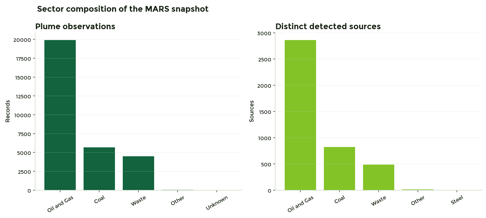
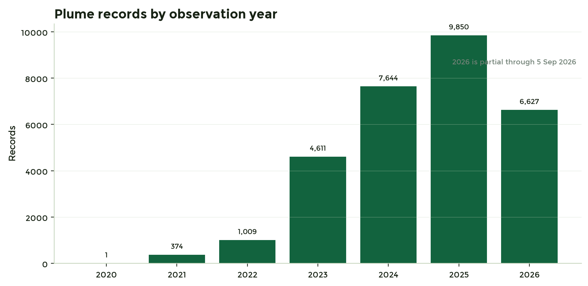
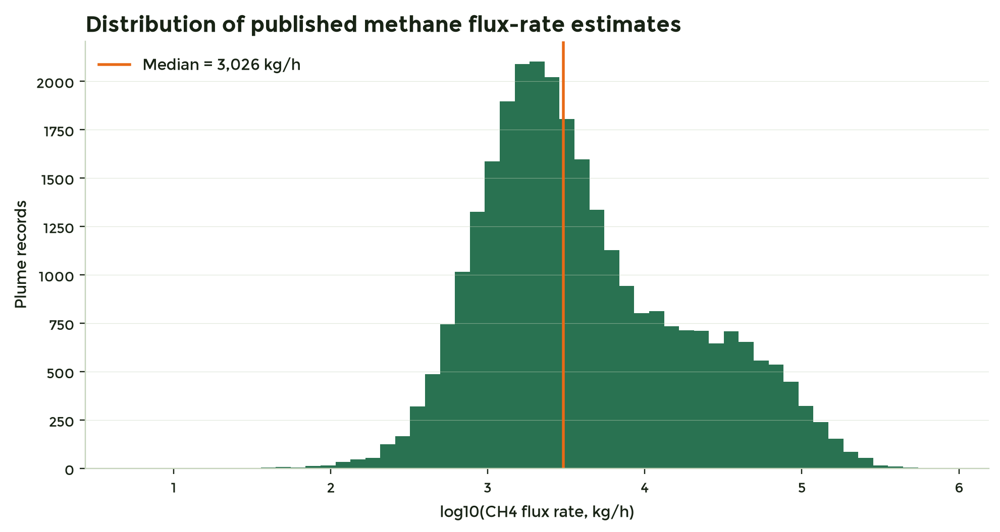
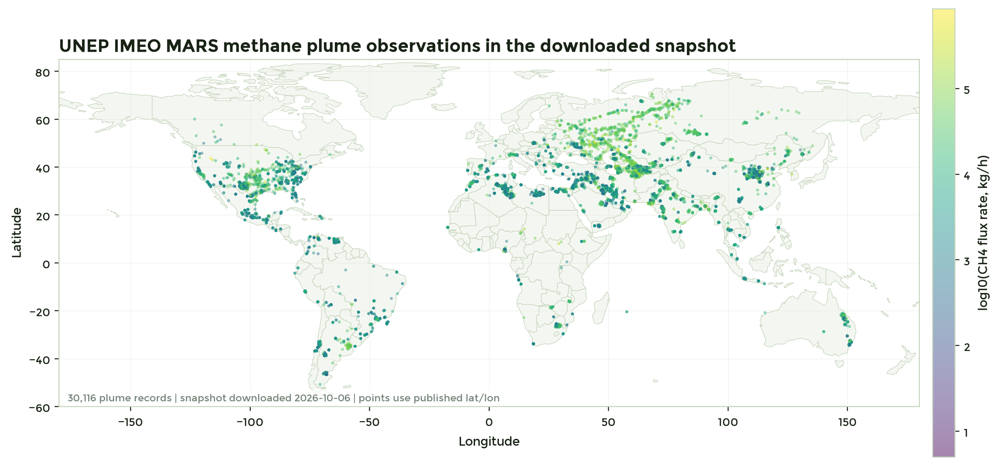

# A Reproducible QA/QC Pipeline for Public Satellite Methane Plume Data from UNEP IMEO MARS

**Marcel de Mello Innocentini**  
Agropixel  
ORCID: https://orcid.org/0009-0006-2409-0946

**Technical Report - Version 1.0.0**  
Dataset snapshot retrieved: 6 October 2026

## Abstract

Reliable methane monitoring requires more than atmospheric retrieval algorithms. Public satellite-derived products also need traceable ingestion, schema normalization, data-quality controls, geospatial persistence, and reproducible outputs before they can support downstream analysis or operational workflows. This technical report presents a compact data-engineering pipeline built around the public Methane Alert and Response System (MARS) plume and source data released by the United Nations Environment Programme's International Methane Emissions Observatory (UNEP IMEO) through the Eye on Methane platform.

The workflow intentionally starts from already processed methane detections. It does not implement atmospheric methane retrieval, radiative transfer, plume-detection machine learning, or an alternative to MARS. Instead, it demonstrates provenance capture, GeoJSON ingestion, deterministic QA/QC, normalization to a portable geospatial layer, a PostgreSQL/PostGIS loading path, automated tests, and machine-readable reporting. The downloaded snapshot contains 30,116 plume observations and 4,186 detected sources spanning 99 countries and ten satellite/instrument labels. The implemented QA/QC rules classified 27,871 records as PASS, 2,245 as WARN, and none as FAIL under the defined critical checks. The resulting workflow provides a small, transparent example of downstream environmental remote-sensing data engineering.

**Keywords:** methane; satellite remote sensing; UNEP IMEO; MARS; Eye on Methane; QA/QC; GeoPandas; PostGIS; geospatial data engineering; reproducible research.

---

## 1. Context and scope

Methane is monitored by an increasingly heterogeneous constellation of satellite instruments. These systems differ in spatial resolution, spectral configuration, revisit behavior, coverage, tasking, retrieval method, and minimum detectable emission rate. UNEP IMEO's Methane Alert and Response System (MARS) integrates observations from more than 30 satellite instruments with scientific expertise and analytical workflows to turn large methane detections into actionable information for governments and operators.

This report addresses a deliberately narrower problem: **what happens after a methane detection product is already publicly available?** The objective is to demonstrate a reliable downstream workflow that can receive a real environmental Earth-observation dataset, validate it, structure it, persist it, and generate reproducible summaries.



The scope boundary is explicit. This work does **not**:

- retrieve XCH4 or methane enhancements from radiances;
- implement radiative-transfer calculations;
- detect methane plumes from imagery;
- train machine-learning models;
- reproduce UNEP IMEO scientific quantification methods;
- infer missing atmospheric parameters;
- claim equivalence with the operational MARS infrastructure.

It instead treats the official MARS public export as the authoritative upstream product.

## 2. Data source and provenance

The primary input is the UNEP IMEO Eye on Methane MARS public export in GeoJSON format. The official data dictionary defines a **plume** as a single methane emission observation from one satellite overpass and a **source** as a ground location at which one or more plumes have been detected over time.

The archive downloaded on 6 October 2026 contained:

| Item | Value |
|---|---:|
| Plume observations | 30,116 |
| Detected sources | 4,186 |
| Countries represented | 99 |
| Satellite/instrument labels | 10 |
| Earliest plume timestamp | 2020-10-29 14:34:04 UTC |
| Latest plume timestamp | 2026-09-05 10:08:06 UTC |
| Archive size | 54,940,454 bytes |
| SHA-256 | 3755cc5206f6c60c770fe589d527a98f73779e16fe752f40dda6e120935ed03e |

The official package also contained the data dictionary and the CC BY-NC-SA 4.0 license text. The pipeline stores the retrieval timestamp, source URL, archive size, file list, and SHA-256 hash in `data/raw/provenance.json`.

The MARS data dictionary notes that plumes detected by Sentinel-2, Landsat-8/9, EMIT, PRISMA and EnMAP in Eye on Methane were requantified after 20 February 2026. This makes snapshot provenance especially important: values in a later download may differ from an earlier archive even for previously observed events.

## 3. Dataset structure

The plume export includes unique plume identifiers, source identifiers, satellite/instrument labels, observation timestamps, WGS84 latitude and longitude, sector, actionability and notification attributes, methane flux-rate estimates and uncertainties, wind components, and optional plume geometries.

For downstream persistence, the workflow creates a normalized point representation from the published latitude/longitude fields while preserving whether the original plume footprint was present and valid. This choice provides a consistent spatial key for storage and indexing without attempting to reconstruct missing plume shapes.



The executed local artifact is a GeoPackage in EPSG:4326. A separate SQL schema and loader provide an optional PostgreSQL/PostGIS operational path with:

- primary key on `id_plume`;
- `geometry(Point,4326)`;
- GIST spatial index;
- timestamp index;
- satellite index;
- idempotent UPSERT behavior.

## 4. QA/QC design

The QA/QC layer is deterministic and record-level. Checks are divided into **critical** and **warning-level** conditions.

Critical checks:

1. missing plume identifier;
2. duplicated plume identifier;
3. invalid or missing observation timestamp;
4. missing coordinates;
5. latitude outside [-90, 90];
6. longitude outside [-180, 180];
7. negative methane flux rate.

Warning-level checks:

1. missing methane flux rate;
2. missing original plume geometry;
3. invalid original plume geometry.

A record receives:

- **PASS** when no checks are triggered;
- **WARN** when only non-critical checks are triggered;
- **FAIL** when one or more critical checks are triggered.

This classification is intentionally conservative. A record without a published plume footprint remains usable for location-level ingestion when its published latitude/longitude is valid, so the missing footprint is flagged rather than discarded.



### QA/QC outcome

| Status / flag | Count | Share of plume records |
|---|---:|---:|
| PASS | 27,871 | 92.545% |
| WARN | 2,245 | 7.455% |
| FAIL | 0 | 0.000% |
| Missing CH4 flux rate | 1,038 | 3.447% |
| Missing original geometry | 1,207 | 4.008% |
| Duplicate plume ID | 0 | 0.000% |
| Invalid date | 0 | 0.000% |
| Missing coordinates | 0 | 0.000% |
| Coordinates outside valid ranges | 0 | 0.000% |
| Negative flux rate | 0 | 0.000% |
| Invalid original geometry | 0 | 0.000% |

The absence of FAIL records under these checks should not be interpreted as a validation of the scientific methane retrieval itself. It means that the exported records were structurally consistent with the downstream rules applied here.

## 5. Snapshot composition

### 5.1 Satellite and instrument mix

The snapshot is multi-sensor. EMIT accounts for the largest number of plume records, followed by Sentinel-5P/TROPOMI and Sentinel-2.



The instrument mix is a property of this public MARS snapshot and the upstream observation strategy. It is not a measure of instrument performance. Different systems have different detection limits, spatial resolution, revisit characteristics, targeting strategies and data availability.

TROPOMI is particularly important as a wide-swath methane product. Its Level-2 methane product provides column-averaged methane information with broad coverage, while MARS uses TROPOMI-based hotspot information among several inputs for targeting and monitoring higher-resolution observations.

### 5.2 Sector mix

Oil and gas is the dominant sector in both plume observations and detected sources in this snapshot.



This concentration should not be interpreted as a sector-neutral inventory of global methane emissions. UNEP notes that MARS historically focused strongly on the oil and gas sector and that coverage is expanding to other sectors such as coal, waste and agriculture.

### 5.3 Observation timeline



The number of plume records rises strongly from 2023 onward. The 2026 bar is partial through 5 September 2026. The series reflects the evolution of MARS, sensor availability, targeting, validation, public-data coverage and processing, and should not be interpreted as a direct physical trend in global methane emissions.

## 6. Published flux-rate fields

The public dataset includes methane flux-rate estimates in kg/h for most plume records. In the downloaded snapshot, 29,058 records contain a positive flux-rate value after numeric validation.

The median positive published flux rate is approximately **3,027 kg/h**, with an interquartile range from approximately **1,393 to 11,000 kg/h**. The 95th percentile is approximately **73,000 kg/h**.



These statistics summarize values present in the public export. No cross-sensor recalibration, uncertainty harmonization, retrieval reprocessing, or physical reinterpretation is performed here. Because sensor characteristics and quantification approaches differ, comparisons across instruments require scientific context beyond this data-engineering demonstration.

## 7. Spatial distribution

The downloaded snapshot spans 99 countries. The map below displays plume locations using the published WGS84 latitude/longitude fields and colors records with positive flux estimates by log10 flux rate.



The spatial pattern reflects where MARS has detected and published plumes, not a complete map of methane emissions. Geographic coverage depends on instrument capability, cloud and surface conditions, targeting, observation opportunities, retrieval sensitivity, validation and sectoral program priorities.

The MARS data dictionary further notes that Sentinel-5P source coordinates are approximate and automatically generated based on the plume mask and wind direction. Accordingly, the point representation should be interpreted at the level supported by the upstream product.

## 8. Reproducibility and software structure

The workflow is designed to be rerun from an official download rather than depending on a manually curated local dataset.

A complete run performs:

1. download of the current official UNEP archive;
2. archive integrity check and extraction;
3. provenance hashing;
4. GeoJSON ingestion;
5. type normalization;
6. deterministic QA/QC flags;
7. normalized point geometry creation;
8. GeoPackage output;
9. lightweight GeoJSON sample output;
10. CSV/JSON QA summaries;
11. publication figures;
12. automated tests.

Core commands:

```powershell
python src\download_data.py
python -m pytest -q
python src\run_pipeline.py
python src\publication_assets.py
python src\build_publication_report.py
```

The current test suite passes 2/2 tests and the produced GeoPackage was read back successfully with all 30,116 normalized records.

The repository also includes a Dockerfile and a PostGIS loader so that the same pipeline can be moved from a portable local demonstration toward a service-backed environment without changing the QA logic.

## 9. Limitations

The project is intentionally limited in scope.

**No atmospheric retrieval.** The project begins with already processed MARS detections. It does not retrieve methane from radiances, estimate background concentrations, run radiative transfer, derive plume masks, or implement IMEO quantification methods.

**Snapshot dependence.** Eye on Methane data can be updated and reprocessed. Results are tied to the 6 October 2026 download and its SHA-256 hash.

**No completeness claim.** MARS public records are not a complete census of methane emissions. Observation opportunities and detection sensitivity vary by instrument, geography, surface properties, cloud conditions and program priorities.

**No sensor-performance ranking.** Record counts by satellite reflect the dataset composition, not comparative scientific performance.

**No trend inference.** Annual record counts reflect the evolving observing system and public dataset, not a controlled time series of global methane emissions.

**No cross-sensor harmonization.** Published flux rates are summarized as provided. No attempt is made to harmonize uncertainties or methodologies across sensors.

**Point normalization.** The persistent point layer uses published lat/lon. Original plume footprints are not reconstructed when absent.

## 10. Licensing, attribution and publication model

The UNEP Eye on Methane MARS dataset is distributed under **Creative Commons Attribution-NonCommercial-ShareAlike 4.0 International (CC BY-NC-SA 4.0)**. Derived figures, tables, the lightweight sample and this report are therefore distributed under the same license and explicitly identify the source and modifications.

Attribution for derived material:

> Contains data derived from UNEP International Methane Emissions Observatory (IMEO), Eye on Methane / Methane Alert and Response System (MARS), downloaded 6 October 2026. Data were normalized, quality-flagged, aggregated and visualized for this independent technical demonstration. Original MARS data are licensed CC BY-NC-SA 4.0. This work is not produced by or endorsed by UNEP or IMEO.

The pipeline source code is independently authored and distributed under the **MIT License**. Natural Earth boundaries used only as cartographic context are public-domain data.

The publication is intentionally split into:

- **GitHub repository:** software, tests, reproducibility instructions, derived publication assets and provenance;
- **Zenodo technical report:** citable PDF report with its own DOI and CC BY-NC-SA 4.0 license.

This separation preserves clear licensing and gives the illustrated report a stable scholarly citation.

## 11. Conclusions

A small downstream pipeline is sufficient to demonstrate several capabilities that matter for operational environmental Earth-observation systems: provenance, schema discipline, geospatial normalization, deterministic validation, explicit quality flags, reproducible summaries, spatial persistence and transparent limitations.

The main outcome is not a new methane retrieval algorithm. It is a defensible data-engineering layer around a real public methane EO product. The workflow receives an official MARS snapshot, validates its structure, preserves source provenance, creates a portable spatial representation, exposes a PostGIS loading path, and produces machine-readable and illustrated outputs without overstating the scientific scope.

This boundary is a strength of the demonstration: it shows how existing remote-sensing and geospatial engineering practices can be transferred to methane data while respecting the distinction between **data engineering** and **atmospheric retrieval science**.

## References

1. United Nations Environment Programme (UNEP). *Methane Alert and Response System (MARS).* https://www.unep.org/topics/energy/methane/methane-alert-and-response-system-mars
2. United Nations Environment Programme (UNEP). *UNEP IMEO Technical Documentation for Methane Satellite Detection and Quantification.* September 2024. https://wedocs.unep.org/handle/20.500.11822/46241
3. UNEP IMEO. *Eye on Methane - Download data set.* https://methanedata.unep.org/download-dataset
4. UNEP IMEO. *Data dictionary: MARS methane plumes and sources.* https://methanedata.unep.org/dict-mars-plumes
5. TROPOMI. *Methane (L2__CH4___) product documentation.* https://www.tropomi.eu/data-products/methane
6. Copernicus Atmosphere Monitoring Service. *Methane Hotspot Explorer.* https://apps.atmosphere.copernicus.eu/methane-explorer/
7. European Space Agency. *Copernicus Sentinel-5P TROPOMI Level 2 Methane products, Version 02.* DOI: 10.5270/S5P-3lcdqiv
8. Creative Commons. *Attribution-NonCommercial-ShareAlike 4.0 International.* https://creativecommons.org/licenses/by-nc-sa/4.0/
9. Natural Earth. *Natural Earth vector map data.* https://www.naturalearthdata.com/

---

**Suggested citation**

Innocentini, M. de M. (2026). *A Reproducible QA/QC Pipeline for Public Satellite Methane Plume Data from UNEP IMEO MARS* (Version 1.0.0). Zenodo. https://doi.org/10.5281/zenodo.23196446

**License:** CC BY-NC-SA 4.0 for this report and derived UNEP-data figures/tables.  
**Code license:** MIT.  
**Repository URL planned:** https://github.com/marcel-innocentini/methane-imeo-data-engineering
